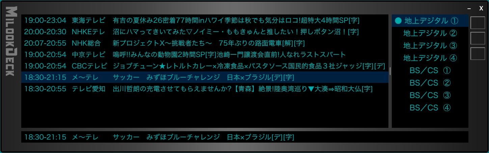
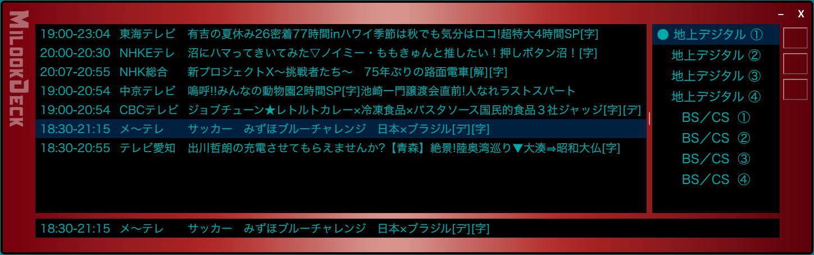
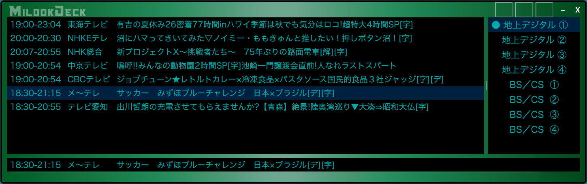
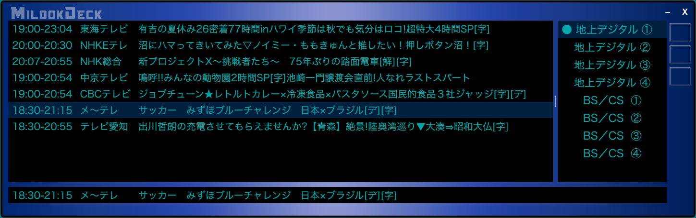
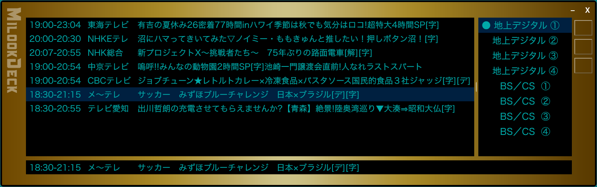

# MilookDeck for TVTest + EDCB

**MilookDeck**(ミルックデック)  
Milookは Miru(見る／観る)とLookを組み合わせた造語です。

**TvRock** の **Rockバー** のオマージュ。  
複数の [TVTest](https://github.com/DBCTRADO/TVTest) を、1つの小さなリモコン画面から操作する Windows 用ソフトです。  
[EDCB](https://github.com/xtne6f/EDCB) が取得した EPG データを使って、**今放送中の番組**を局ごとに一覧表示し、番組名をダブルクリックするだけで視聴を始められます。

- チューナー(BonDriver)ごとに TVTest を起動・終了
- 放送中の番組を一覧表示し、番組名をダブルクリックで局を切り替え
- 番組名を右クリックすると、その局の 48 時間先までの番組一覧を表示
- EDCB の録画予定と連携(録画中・録画予定のチューナーでは TVTest を起動しない / 視聴中なら自動で終了)
- タスクトレイ常駐、ダーク/ライトテーマ、色・フォント・配置のカスタマイズ

<table>
  <tr>
    <td align="center"> 縦ボタンレイアウト(背景画像：Black)</td>
    <td align="center"> 縦ボタンレイアウト(背景画像：Red)</td>
  </tr>
  <tr>
    <td align="center"> 横ボタンレイアウト(背景画像：Green)</td>
    <td align="center"> ミックスレイアウト(背景画像：Blue)</td>
  </tr>
  <tr>
    <td align="center"> 縦ボタンレイアウト(背景画像：Gold)</td>
    <td></td>
  </tr>
</table>

ボタンのレイアウトは「縦」「横」「ミックス」から、背景は色または好きな画像から選べます。

## 動作環境

| 項目 | 内容 |
|---|---|
| OS | Windows 10 / 11(x64) |
| 実行 | .NET 10 以降のデスクトップ ランタイム(x64) |
| TVTest | MilookDeckBridge プラグインを使います(TVTest と同じビット数でビルドしてください) |
| EDCB | EpgTimerSrv が動いていること(EPG データの取得と録画予定の連携に使用) |

動作確認は、xtne6f 版 EDCB(work-plus-s)と TVTest の組み合わせで行っています。

## 構成

| フォルダ | 内容 |
|---|---|
| `App` | リモコン本体(WPF) |
| `Core` | EPG の読み込み、EDCB との通信、設定など(クラスライブラリ) |
| `Plugin` | TVTest プラグイン `MilookDeckBridge.tvtp`(C++) 局の切り替えと状態の取得を担当 |

MilookDeck 本体と TVTest プラグインは、名前付きパイプ(`\\.\pipe\MilookDeck_<TVTest の PID>`)で通信します。

## ビルド

### 必要なもの

- Visual Studio 2026(「.NET デスクトップ開発」と「C++ によるデスクトップ開発」のワークロード)
- .NET 10 SDK
- TVTest プラグイン SDK のヘッダー(`Plugin\TVTestPlugin.h` 同梱していますが、更新する場合は TVTest 本体のソースから入手してください)

### 手順

1. `MilookDeck.sln` を開く
2. 構成を **Release / x64** にする
3. ソリューション全体をビルドする

出力先:

- 本体: `App\bin\x64\Release\...\`(`...` の部分は .NET のバージョンによって変わります)
- プラグイン: `Plugin\bin\Release\MilookDeckBridge.tvtp`

本体の出力フォルダには、動作に必要な次の 5 つのファイルがあります。これらを同じフォルダにまとめて配置してください。(`.pdb` は不要です)

- `MilookDeck.exe`
- `MilookDeck.dll`
- `MilookDeck.Core.dll`
- `MilookDeck.deps.json`
- `MilookDeck.runtimeconfig.json`

> プラグインは TVTest.exe と同じビット数(64bit 版 TVTest なら x64)でビルドしてください。
> `Plugin\MilookDeckBridge.vcxproj` のプラットフォーム ツールセットは `v145`(Visual Studio 2026 の「x64/x86 の MSVC ビルド ツール (最新)」)です。Visual Studio の画面では「v145」ではなく「MSVC ビルド ツール (最新)」と表示されます。Visual Studio 2022 でビルドする場合は `v143` に書き換えてください。

## セットアップ

1. `MilookDeckBridge.tvtp` を、使用する TVTest の `Plugins` フォルダにコピーする
2. 複数の TVTest を同時に起動するので、TVTest 側で多重起動を許可しておく
3. `MilookDeck.exe` を起動する(初回は設定画面が自動で開きます)
4. 設定画面で次の項目を入力して「OK」を押す
   - **TVTest 実行ファイル**(起動オプションも指定できます)
   - **EDCB フォルダ**
   - **チューナー数**と、各チューナーの表示名・種別(地デジ・BS/CS)・使用する BonDriver

局の一覧は、TVTest の `BonDriver` フォルダにある `.ch2` から読み込みます。事前に TVTest でチャンネルスキャンをしておいてください。

## 使い方

| 操作 | 動作 |
|---|---|
| チューナーをダブルクリック | そのチューナーで TVTest を起動(起動中ならその TVTest を終了) |
| 番組名をダブルクリック | 選択中のチューナーで、その局に切り替え(未起動なら起動してから切り替え) |
| 番組名にマウスを重ねる | 番組内容(日時・概要・拡張情報・映像・音声・ジャンル)をポップアップ表示 |
| 番組名を右クリック | その局の 48 時間先までの番組一覧に切り替え |
| 番組一覧で右クリック →「iEPG関連付け録画予約」 | その番組を EDCB に録画予約(EpgTimer.exe に iEPG ファイルを渡します) |
| 番組一覧で左クリック | 元の「今の番組」一覧に戻る |
| 画面上部を右クリック →「設定」 | 設定画面を開く |
| タスクトレイのアイコンを右クリック | 「閉じる」「設定」「スリープ」のメニューを表示 |

- 地デジのチューナーを選ぶと地デジの局だけ、BS/CS のチューナーを選ぶと BS/CS の局だけが一覧に出ます。
- TVTest を終了したときのチャンネルは、MilookDeck では記憶しません。TVTest の「初期チャンネル」設定(前回終了時のチャンネル)に任せています。
- 本体の位置とサイズは記憶されます。
- タスクトレイのアイコンは、設定で「タスクトレイに常駐する」を有効にしているときに表示されます。
- メニューの「スリープ」を選ぶと確認のウィンドウが開き、30 秒のカウントダウンを表示します。カウントダウンが 0 になるか「すぐにスリープ」を押すと、PC をスリープします。「キャンセル」(Esc キー、ウィンドウの閉じるボタンも同じ)で中止します。

### EDCB との連携

EpgTimerSrv のパイプと `Setting\Reserve.txt` から、チューナーごとの録画状況を調べます。

- EDCB が録画中のチューナーでは、TVTest を起動せず「EDCBにて録画中のため起動できません」と表示します。
- 3分以内に録画予定があるチューナーでは、「EDCBにて録画予定のため起動できません」と表示します。
- 視聴中の TVTest は、録画予定の4分前から「録画予定のため n 秒後に視聴を終了します」とカウントダウンし、3分前に自動で終了します。
- TVTest を全画面で視聴中は、同じカウントダウンを画面の上部中央に重ねて表示します。

### 設定項目

- **動作設定**: TVTest 実行ファイルと起動オプション、EDCB フォルダ、起動ボタン(最大5個。任意のソフトを登録できます)、チューナー、タスクトレイ常駐、スタートアップへの登録(スタートアップフォルダにショートカットを作り、Windows のサインイン時に自動で起動)
- **表示設定**: テーマ(Windows に合わせる / ライト / ダーク)、ボタンレイアウト(縦 / 横 / ミックス)、フォント・サイズ・太さ、チューナー欄の幅と文字の揃え(左・中央・右)、番組内容の表示(表示する/しない、表示するまでの時間)、番組内容の幅、独自ダイアログによる色変更(3セット保存可能)、本体の背景画像(「ソフト本体の色」の代わりに、PC 内の画像ファイルを指定。ウィンドウの大きさに合わせて拡大・縮小)、局名の表示名変更と非表示

設定は `MilookDeck.exe` と同じフォルダの `MilookDeck.settings.json` に、ウィンドウの位置や非表示の局は `MilookDeck.state.json` に保存されます。

## 既知の注意点

- EPG は EDCB が書き出す `Setting\EpgData` を読みます。EDCB 側で EPG の取得が動いていないと、番組情報は更新されません。
- EPG の更新確認と一覧の更新は、時計の 00 秒に合わせて 60 秒ごとに行います。

## 出典・謝辞

- `Core\AribGaiji.cs`(ARIB の追加記号・追加漢字を文字に置き換える表)は、[EDCB](https://github.com/xtne6f/EDCB) の `EpgDataCap3\ARIB8CharDecode.cpp` の表を参考にして作成しました。
- `Plugin\TVTestPlugin.h` は、[TVTest](https://github.com/DBCTRADO/TVTest) のプラグイン用ヘッダー(作者: DBCTRADO、CC0)です。

## ライセンス

[MIT License](LICENSE)
